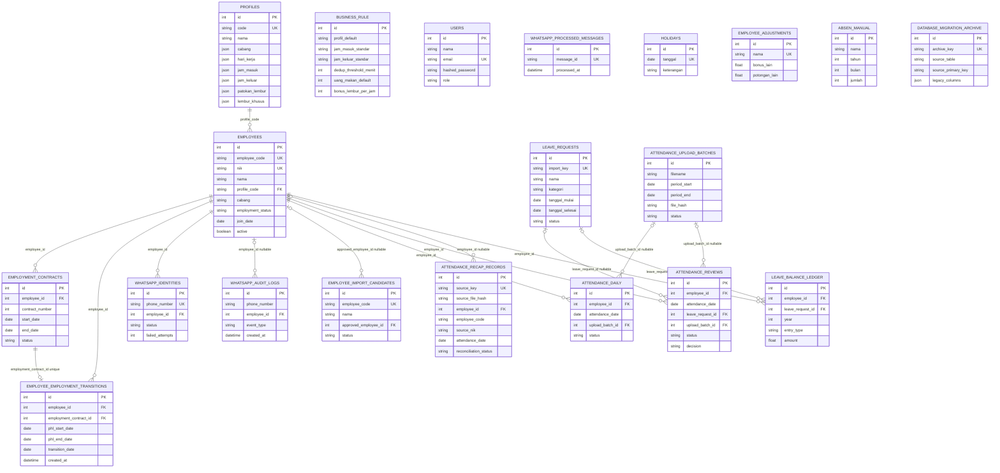

# ERD Database HR Analyst

Diagram berikut mengikuti tabel SQLAlchemy pada `backend/app/models.py` dan hanya menggambar relasi yang memiliki foreign key database. Kolom teks yang kebetulan menyimpan nama atau kode bisnis tidak dianggap relasi FK.

## Batasan interpretasi

- `LEAVE_REQUESTS.nama`, `EMPLOYEE_ADJUSTMENTS.nama`, dan `ABSEN_MANUAL.nama` bukan foreign key ke `EMPLOYEES`; pencocokan berbasis nama pada sebagian jalur tidak menjamin integritas referensial.
- `EMPLOYEE_IMPORT_CANDIDATES.approved_employee_id`, relasi leave pada review/ledger, relasi upload batch, dan relasi karyawan pada rekap/WhatsApp audit dapat bernilai `NULL` sesuai model.
- `EMPLOYEE_EMPLOYMENT_TRANSITIONS` merekam periode PHL hanya pada proses transisi PHL → PKWT yang baru disimpan; tidak ada data transisi lama yang di-backfill otomatis.
- `EMPLOYEE_CODE` pada rekap kehadiran merupakan nilai sumber untuk rekonsiliasi, bukan FK ke `EMPLOYEES.employee_code`.
- Tabel konfigurasi global, akun, pesan webhook yang sudah diproses, hari libur, penyesuaian, absen manual, dan arsip migrasi tidak memiliki FK langsung lain pada model.
- Field ringkas yang ditampilkan bukan daftar lengkap kolom fisik. Gunakan model SQLAlchemy dan skema database pada environment sasaran sebagai referensi lengkap.
